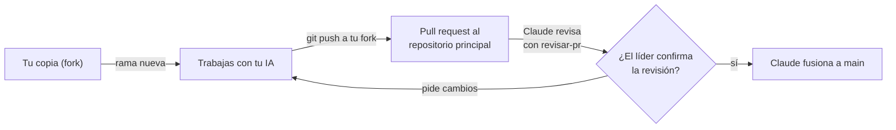

# Equipo y forma de trabajo

Este documento es común para todo el equipo. Cada integrante tiene además su guía personal con sus tareas, paso a paso:

| Persona | Rol | Guía |
|---|---|---|
| Líder ([@rafajaque](https://github.com/rafajaque)) | Líder de arquitectura: base de datos, privacidad y consentimiento, panel de seguimiento (lógica), decisiones finales | [`guia-rafael.md`](guia-rafael.md) |
| Alejandro | Interfaz y diseño: portal, guía del FUAS, pantallas del panel y del consentimiento, accesibilidad, prueba de uso | [`guia-alejandro.md`](guia-alejandro.md) |
| Cristóbal | Datos y contenido: fuentes oficiales, ficha de carrera y puntaje ponderado, hitos del FUAS, textos, prueba de uso | [`guia-cristobal.md`](guia-cristobal.md) |
| Claude | Revisión de cada cambio, documentación, verificación de fuentes, fusión a `main` | — |

**Entrega final: 19 de diciembre de 2026.**

**Qué entregamos:** un sitio gratuito para estudiantes de 3.º y 4.º medio de liceos con financiamiento público (Región de O'Higgins, Colchagua) y un panel interactivo de seguimiento para colegios, de los estudiantes que lo autorizan, validados con 5 estudiantes y 2 profesionales de colegios entre el 24 y el 30 de noviembre ([ADR 0031](../decisiones/0031-producto-y-organizacion.md); [Entregable Parte I](../entregable/Entregable_Parte_I.md), puntos 3 y 10). **Fuera del alcance** (escalabilidad): permanencia en educación superior, pulso de check-in, predicción de deserción, panel para instituciones de educación superior y pruebas propias por colegio. Cada guía personal parte de las Tablas 3.7 (Gantt), 3.8 (RACI) y 3.10 (entregables).

> **¿Primera vez con GitHub?** Empieza por [`primeros-pasos-github.md`](primeros-pasos-github.md): instalación, conexión de tu IA, el ciclo de cada tarea comando por comando y tu semana 1 día por día.

---

## 1. Cómo se trabaja: el camino de un cambio



1. **Nunca trabajas directo en el repositorio principal.** Trabajas en tu copia personal (fork) y desde ahí propones cambios.
2. **Una tarea = una rama = un pull request (PR).** Nada de mezclar dos tareas.
3. **Abres el PR** desde tu fork hacia `AE-SE/Agencia-de-Enlaces-y-Seguimiento-Estudiantil`, rama `main`, completando la plantilla.
4. **Avisas en el grupo del equipo** con el enlace del PR.
5. **Claude revisa** con la pauta [`revisar-pr`](../../.claude/skills/revisar-pr/SKILL.md) y el líder confirma o pide cambios.
6. **Si hay cambios pedidos:** los haces en la misma rama y vuelves a subir. El PR se actualiza solo.
7. **Claude fusiona** a `main` como un solo commit. El líder cierra el PR.
8. **Actualizas tu fork** antes de empezar la siguiente tarea (sección 3).

Tiempo esperado de revisión: dentro del mismo día si avisas antes de las 20:00.

---

## 2. Preparación (una sola vez)

### 2.1 Programas

| Programa | Versión | Para qué |
|---|---|---|
| Git | La más reciente | Control de versiones |
| Node.js | Versión LTS vigente | La aplicación web (Next.js) |
| Python | 3.12 o superior | Scripts de datos y de diseño |
| Editor | VS Code u otro | Escribir código |

### 2.2 Acceso al repositorio

1. Acepta la invitación de GitHub que te llegó por correo. Tu permiso en el repositorio principal es de **lectura**: puedes hacer fork y abrir PR desde él, pero no puedes escribir directo en el principal. Así un push por error a `main` es imposible.
2. Entra a https://github.com/AE-SE/Agencia-de-Enlaces-y-Seguimiento-Estudiantil y haz clic en **Fork** (arriba a la derecha). Se crea tu copia en tu cuenta.
3. Clona **tu fork** (no el principal) y conéctalo con el principal:

```bash
git clone https://github.com/TU_USUARIO/Agencia-de-Enlaces-y-Seguimiento-Estudiantil.git
cd Agencia-de-Enlaces-y-Seguimiento-Estudiantil
git remote add principal https://github.com/AE-SE/Agencia-de-Enlaces-y-Seguimiento-Estudiantil.git
git remote -v   # debe mostrar "origin" (tu fork) y "principal"
```

4. Configura tu nombre y correo para que tus commits queden a tu nombre:

```bash
git config user.name "Tu Nombre"
git config user.email "tu-correo@ejemplo.cl"
```

5. Instala las dependencias de los scripts y verifica que todo funcione:

```bash
pip install -r scripts/requirements.txt
python3 scripts/tokens.py --check   # todas las líneas deben decir [ok] (44 al 11 de noviembre)
```

### 2.3 Tu IA de confianza

Al empezar **cada conversación** con tu IA, entrégale en este orden:

1. [`AGENTS.md`](../../AGENTS.md) completo.
2. Este archivo.
3. Tu guía personal.
4. La skill de [`.claude/skills/`](../../.claude/skills/) de la tarea.
5. La tarea concreta (cada tarea de tu guía trae un texto listo para copiar).

Si usas Claude Code, los pasos 1 y 4 los hace solo.

---

## 3. Comandos del día a día

```bash
# Antes de empezar una tarea: traer lo último del principal
git checkout main
git pull principal main
git push origin main

# Crear la rama de la tarea
git checkout -b feat/explorador-de-carreras

# Guardar avances (todas las veces que quieras)
git add -A
git commit -m "feat: agrega filtros por región al explorador"

# Subir a tu fork
git push -u origin feat/explorador-de-carreras
# GitHub te muestra un enlace para crear el pull request: ábrelo
```

**Nombres de rama:** `feat/` funcionalidad, `fix/` corrección, `docs/` documentación, `datos/` carga de datos.
**Mensajes de commit:** en español, empezando con `feat:`, `fix:`, `docs:`, `datos:`, `test:` o `chore:`.

---

## 4. Calendario hasta el 19 de diciembre

Es el Gantt de la Tabla 3.7. El detalle por persona, con criterios de aceptación, está en cada guía.

| Fase | Semana | Líder | Alejandro | Cristóbal | Hito |
|---|---|---|---|---|---|
| F1 · Datos oficiales y ficha de carrera (OE1) | S1 y S2 (3 al 16 nov) | Base de datos y RLS; aprobar | Ficha, explorador, comparador | Cargas oficiales, fórmula del ranking | Ficha con fuente y fecha (**hecha en lo central**) |
| F2 · Guía de trámites y plazos del FUAS (OE2) | S2 y S3 (10 al 23 nov) | Aprobar | Guía y calendario | Hitos con fuente y vigencia | Guía y calendario con vigencia |
| OE1 completo | **Lun 23 nov** | Revisar el simulador (PR 132) | Simulador y puntaje, arancel y beneficio a la vista | Casos del puntaje ponderado; 100 % de datos con fuente | I-OE1a = 100 % |
| F3 · Panel de seguimiento (OE3) | S3 y S4 (17 al **27 nov**, congelamiento de funciones) | Panel (lógica), consentimiento y aislamiento con pruebas | Pantallas del panel y del consentimiento | Textos y datos de metas de carrera | Panel con datos ficticios |
| F4 · Validación | S4 (24 al 30 nov) | Reclutar colegios y autorizaciones | Observar, anotar y corregir | Organizar las sesiones y el informe | 16 de 20 tareas sin ayuda |
| F5a · Todo fusionado y correcciones | **Mar 1 dic** y 1 al 4 dic | Fusionar todo a `main`; revisar `fix/…` | Corregir hallazgos de la prueba | Corregir datos y textos hallados | Ningún PR de función abierto; hallazgos graves corregidos |
| F5b · Pruebas y mejoras leves | 7 al 11 dic | Privacidad, consentimiento y aislamiento; revisión de PR | Auditoría de accesibilidad; pulido de interfaz | Verificación de datos con fuente; mejoras leves de la ficha | Pruebas 100 % aprobadas; 100 % de datos con fuente |
| F5c · Documentación e informe | 14 al 17 dic (último PR de código: mar 15) | Informe final | Informe de la prueba | Informe de datos | Informes sin marcas `[COMPLETAR]` |
| F5d · Cierre | 18 y 19 dic | Revisión final y presentación | Presentación | Presentación | **Entrega el 19 dic** |

**Ritmo de las próximas semanas:** el desarrollo de funciones termina el **viernes 27 de noviembre**; el **martes 1 de diciembre** todo debe estar fusionado a `main`. La ventana del 1 al 17 de diciembre es para pulir y probar (correcciones, accesibilidad, verificación de datos, mejoras leves, documentación e informe), no para terminar lo pendiente. Una mejora leve no agrega pantallas, tablas ni dependencias, cabe en un PR de menos de 150 líneas y no toca consentimiento ni aislamiento; lo demás pasa a proyección. **Revisión de PR: martes (1, 8 y 15 dic) y viernes (27 nov, 4 y 11 dic).**

**Hito al cierre de cada semana** (lunes 16 y 23, viernes 27 de noviembre y viernes 4 y 11 de diciembre): algo que se pueda mostrar en un teléfono.

---

## 5. Dependencias entre nosotros

| Quién necesita | Qué | De quién | Para cuándo |
|---|---|---|---|
| Alejandro | Fórmula oficial del ranking 2027 citada (PR 96) | Cristóbal | Vie 13 nov |
| Alejandro | Alcance del panel confirmado | Líder | Mié 18 nov |
| Alejandro | Base de datos y reglas de consentimiento para las pantallas | Líder | Vie 20 nov |
| Cristóbal | Carta a colegios y autorizaciones de tutores | Líder | Lun 23 nov |
| Alejandro y Cristóbal | Todo lo que se prueba, fusionado y publicado | Todos | Lun 23 nov (la prueba empieza el 24) |
| Rafael | Lista de hallazgos de la prueba, con gravedad y arreglo propuesto | Alejandro y Cristóbal | Lun 30 nov |
| Todos | Todo lo comprometido, fusionado a `main` | Todos | Mar 1 dic |
| Alejandro | Datos y textos verificados de cada pantalla para el informe | Cristóbal | Vie 11 dic |
| Alejandro | Textos revisados de cada pantalla | Cristóbal | El día después de cada pantalla |

Si una dependencia no llega en la fecha, **trabaja con datos de ejemplo** y avisa en el grupo ese mismo día. Nunca te quedes esperando sin decir nada.

---

## 6. Reglas que no se negocian (resumen de AGENTS.md)

- Ningún dato sin fuente oficial, URL y fecha. Si no lo puedes verificar, no se publica. Solo fuentes oficiales, primarias o académicas: nunca prensa.
- Ningún color, tamaño ni espacio escrito a mano: solo tokens de diseño.
- Ningún dato real de estudiantes en tu computador, en una IA externa ni en el repositorio. Datos de prueba siempre ficticios. Menores de 18: autorización del tutor.
- Ninguna etiqueta «en riesgo» ni promesa de predicción en pantallas o textos (AGENTS.md 2.4).
- Ninguna clave en el código. Las claves las entrega el líder por un canal privado.
- Ningún "estilo de aprendizaje" (visual/auditivo/kinestésico) en contenidos ni recomendaciones.
- Tú eres responsable del código que subes, aunque lo haya escrito tu IA: léelo y entiéndelo.

---

## 7. Cuando tengas dudas

1. Busca en `AGENTS.md`, `docs/` y tu guía.
2. Pregúntale a tu IA, pasándole esos archivos.
3. Si sigue la duda, **pregunta en el grupo** antes de inventar. Una pregunta de 1 minuto ahorra un PR rechazado.
4. Si tu IA te propone algo que contradice `AGENTS.md`, gana `AGENTS.md`.
