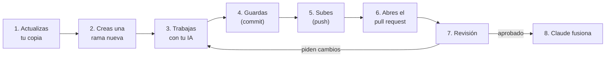

# Primeros pasos con GitHub y tu IA

Esta guía parte desde cero. No necesitas saber nada de GitHub: sigue los pasos en orden, sin saltarte ninguno, y marca cada casilla cuando lo termines.

**Tiempo total:** unas 2 horas la primera vez. Después, cada tarea nueva toma 5 minutos de preparación.

**Si te pierdes en cualquier paso:** detente, toma una captura de pantalla y pregunta en el grupo. No sigas adivinando.

---

## Parte 1 · Lo que tienes que entender (10 minutos)

Imagina que el proyecto es **un libro que escribimos entre todos**.

| Palabra | Qué significa en el ejemplo del libro |
|---|---|
| **Repositorio** | El libro completo, con todo su historial de cambios. Vive en GitHub. |
| **Repositorio principal** | El libro oficial, en la organización del proyecto: `AE-SE/Agencia-de-Enlaces-y-Seguimiento-Estudiantil`. **Tú nunca escribes directo aquí.** |
| **Fork** | Tu fotocopia personal del libro, en tu cuenta de GitHub. Aquí sí escribes. |
| **Clonar** | Bajar tu fotocopia a tu computador para trabajar en ella. |
| **Rama (branch)** | Un borrador aparte para una tarea. Si el borrador sale mal, el libro no se daña. |
| **`main`** | La rama oficial, la versión aprobada del libro. |
| **Commit** | Guardar un avance con una nota de qué cambiaste. |
| **Push** | Subir tus commits desde tu computador a tu fork en GitHub. |
| **Pull request (PR)** | Pedirle al equipo que revise tu borrador y lo agregue al libro oficial. |
| **Fusionar (merge)** | Agregar el borrador aprobado al libro oficial. Lo hace Claude, después de que el líder confirma la revisión. |

**El camino de cada tarea, siempre igual:**



---

## Parte 2 · Instalar lo necesario (30 minutos)

### 2.1 Cuenta de GitHub
- [ ] Si no tienes, crea una cuenta en https://github.com/signup.
- [ ] Activa la verificación en dos pasos: *Settings → Password and authentication → Two-factor authentication*. Protege el proyecto si alguien roba tu contraseña.
- [ ] Mándale tu **nombre de usuario** de GitHub al líder (no tu contraseña, nunca).

### 2.2 Programas

Instala estos cuatro, en este orden. En cada instalador, deja las opciones que vienen marcadas.

| Programa | Dónde | Para qué |
|---|---|---|
| Git | https://git-scm.com/downloads | Guardar y subir cambios |
| GitHub CLI | https://cli.github.com | Conectar tu computador con tu cuenta de GitHub de forma segura |
| Node.js (versión LTS) | https://nodejs.org | Correr la página web |
| Python 3.12 o superior | https://www.python.org/downloads | Correr los scripts del proyecto (en Windows, marca **"Add Python to PATH"**) |

Y un editor: **Visual Studio Code** (https://code.visualstudio.com) es el más simple.

- [ ] **Comprueba que todo quedó instalado.** Abre una terminal (en Windows: "Terminal" o "PowerShell"; en Mac: "Terminal") y escribe una línea a la vez:

```bash
git --version
gh --version
node --version
python3 --version     # en Windows puede ser: python --version
```

Cada una debe responder con un número de versión. Si alguna dice "no se reconoce" o "command not found", reinstala ese programa y cierra y abre la terminal.

### 2.3 Conectar tu computador con GitHub

- [ ] En la terminal:

```bash
gh auth login
```

Responde así (con las flechas y Enter):
1. *Where do you use GitHub?* → **GitHub.com**
2. *Preferred protocol?* → **HTTPS**
3. *Authenticate Git with your GitHub credentials?* → **Yes**
4. *How would you like to authenticate?* → **Login with a web browser**
5. Copia el código de 8 letras que aparece, presiona Enter, pégalo en el navegador y autoriza.

- [ ] Comprueba:

```bash
gh auth status
```

Debe decir que estás conectado con tu usuario.

- [ ] Configura tu nombre y correo (aparecerán en tus cambios):

```bash
git config --global user.name "Tu Nombre Apellido"
git config --global user.email "el-mismo-correo-de-tu-github@ejemplo.cl"
```

> **Regla de seguridad:** nunca le des a tu IA tu contraseña, tu código de verificación ni un "token" de GitHub. Con `gh auth login` tu computador queda conectado y la IA puede trabajar sin conocer ninguna clave.

---

## Parte 3 · Tu copia del proyecto (20 minutos)

### 3.1 Aceptar la invitación
- [ ] Revisa el correo de tu cuenta de GitHub. Busca "invited you to collaborate" y haz clic en **Accept invitation**. También puedes verla en https://github.com/notifications.

### 3.2 Hacer tu fork
- [ ] Entra a https://github.com/AE-SE/Agencia-de-Enlaces-y-Seguimiento-Estudiantil
- [ ] Arriba a la derecha, clic en **Fork** → deja el nombre igual → **Create fork**.
- [ ] Quedas en `https://github.com/TU_USUARIO/Agencia-de-Enlaces-y-Seguimiento-Estudiantil`. Esa es tu copia.

Si el botón Fork no aparece o da error, avisa al líder.

### 3.3 Bajar tu copia al computador
- [ ] Elige una carpeta para tus proyectos (por ejemplo, `Documentos/proyectos`) y abre la terminal ahí. En VS Code: *Archivo → Abrir carpeta* y luego *Terminal → Nueva terminal*.
- [ ] Escribe, cambiando `TU_USUARIO`:

```bash
git clone https://github.com/TU_USUARIO/Agencia-de-Enlaces-y-Seguimiento-Estudiantil.git
cd Agencia-de-Enlaces-y-Seguimiento-Estudiantil
git remote add principal https://github.com/AE-SE/Agencia-de-Enlaces-y-Seguimiento-Estudiantil.git
git remote -v
```

- [ ] El último comando debe mostrar 4 líneas: dos con `origin` (tu fork, con tu usuario) y dos con `principal` (el del líder). Si ves eso, está perfecto.

### 3.4 Probar que todo funciona
- [ ] Dentro de la carpeta del proyecto:

```bash
pip install -r scripts/requirements.txt
python3 scripts/tokens.py --check
```

Todas las líneas deben empezar con `[ok ]` (44 al 11 de noviembre de 2026) y ninguna con `[FALLA]`.

- [ ] Abre la carpeta del proyecto en VS Code y lee el archivo `AGENTS.md`.

---

## Parte 4 · Conectar tu IA

Hay dos tipos de IA, y se usan distinto:

| Tipo | Ejemplos | Cómo trabaja |
|---|---|---|
| **IA que trabaja en tu computador** (recomendada) | Claude Code, GitHub Copilot en modo agente dentro de VS Code, Cursor | Lee los archivos del proyecto, escribe código y corre los comandos de Git por ti. **Tú apruebas cada comando antes de que se ejecute.** |
| **IA de chat en el navegador** | ChatGPT, Gemini, Claude en la web | No ve tu computador. Tú le pegas los archivos, ella te responde con código y comandos, y **tú los copias y ejecutas**. |

### 4.1 Si usas una IA que trabaja en tu computador
1. Abre la carpeta del proyecto en esa herramienta (no una carpeta superior).
2. Como gracias a `gh auth login` tu computador ya está conectado a GitHub, la IA puede usar `git` y `gh` sin claves.
3. Al empezar cada sesión, pégale el **mensaje de inicio** (Parte 7).
4. Cuando te pida permiso para correr un comando, **léelo antes de aprobar**. Rechaza cualquier comando de la lista "Nunca" de la Parte 7 y avisa al líder.

### 4.2 Si usas una IA de chat
1. Al empezar cada conversación, pégale el **mensaje de inicio** (Parte 7) y el contenido de `AGENTS.md`, de tu guía personal y de la skill de la tarea (están en `.claude/skills/`).
2. Pídele el código archivo por archivo, indicando la ruta exacta ("dame el archivo completo `app/_componentes/Boton.tsx`").
3. Copia cada archivo en VS Code en la ruta indicada y guárdalo.
4. Los comandos de Git los corres tú, con la Parte 5.

---

## Parte 5 · El ciclo de cada tarea, comando por comando

Cambia `nombre-de-la-rama` por el que indica tu guía para la tarea (por ejemplo, `feat/componentes-base`).

### Paso 1 · Actualizar tu copia (siempre, antes de empezar)

```bash
git checkout main
git pull principal main
git push origin main
```

Esto trae lo último que se aprobó en el repositorio principal y lo deja también en tu fork.

### Paso 2 · Crear la rama de la tarea

```bash
git checkout -b nombre-de-la-rama
```

Comprueba en qué rama estás (**hazlo cada vez que dudes**):

```bash
git branch --show-current
```

Si dice `main`, **no trabajes todavía**: crea la rama primero.

### Paso 3 · Trabajar
Sigue tu guía personal con tu IA. Guarda los archivos.

### Paso 4 · Guardar avances (commit)
Hazlo cada vez que algo funcione, aunque la tarea no esté terminada:

```bash
git status                  # ve qué archivos cambiaron
git add -A                  # prepara todos los cambios
git commit -m "feat: agrega el botón principal"
```

**Antes de `git add -A` revisa `git status`:** si aparece un archivo `.env`, una carpeta `datos/crudos/` o algo que no reconoces, **no sigas** y pregunta.

Cómo escribir el mensaje: empieza con `feat:` (algo nuevo), `fix:` (corrección), `docs:` (documentación), `datos:` (datos) o `test:` (pruebas), y luego qué hiciste, en español y en presente: "agrega", "corrige", "documenta".

### Paso 5 · Subir a tu fork (push)

La primera vez en cada rama:
```bash
git push -u origin nombre-de-la-rama
```
Las siguientes veces en la misma rama, basta con:
```bash
git push
```

### Paso 6 · Abrir el pull request
Opción con la página web (la más simple):
1. Entra a tu fork en GitHub. Aparece un aviso amarillo con el botón **Compare & pull request**: haz clic.
2. Revisa que arriba diga: `base repository: AE-SE/Agencia-de-Enlaces-y-Seguimiento-Estudiantil`, `base: main` ← `head repository: TU_USUARIO/...`, `compare: nombre-de-la-rama`.
3. Título: el mismo estilo del commit ("feat: componentes base").
4. Completa la plantilla que aparece en el cuadro de texto: cada sección, incluida **"IA utilizada"**. Marca las casillas que cumpliste.
5. Clic en **Create pull request**.

Opción con la terminal:
```bash
gh pr create --repo AE-SE/Agencia-de-Enlaces-y-Seguimiento-Estudiantil --base main --fill
```
y luego completa la plantilla en la página del PR.

- [ ] **Avisa en el grupo** con el enlace del PR.

### Paso 7 · Si te piden cambios
1. Lee los comentarios del PR.
2. **Sin cambiarte de rama**, haz los arreglos con tu IA.
3. `git add -A`, `git commit -m "fix: corrige lo pedido en la revisión"` y `git push`.
4. El PR se actualiza solo. Avisa en el grupo que está listo de nuevo.

### Paso 8 · Cuando tu PR se fusiona
1. Vuelve al Paso 1 (actualizar tu copia).
2. Borra la rama vieja de tu computador: `git branch -D nombre-de-la-rama`.
3. Empieza la siguiente tarea con una **rama nueva**. Nunca reutilices una rama ya fusionada.

---

## Parte 6 · Cuando algo sale mal

| Lo que ves | Qué pasó | Qué hacer |
|---|---|---|
| `Permission denied` o `403` al hacer push | Intentaste subir al repositorio principal en vez de a tu fork | Usa `git push origin …`, nunca `git push principal …` |
| `rejected … non-fast-forward` | Tu fork tiene cambios que tu computador no | `git pull origin nombre-de-la-rama` y vuelve a hacer push. Si sigue, pregunta |
| `CONFLICT (content): Merge conflict in archivo` | Tú y otra persona cambiaron la misma parte de un archivo | No borres nada a ciegas. Abre el archivo en VS Code: muestra las dos versiones con botones para elegir. Si no estás seguro, pregunta |
| Trabajaste en `main` sin querer (y aún no hiciste commit) | Olvidaste crear la rama | `git checkout -b nombre-de-la-rama`: tus cambios se mueven a la rama nueva |
| Hiciste commit en `main` sin querer | Igual que arriba, pero ya guardado | `git branch nombre-de-la-rama`, luego `git checkout nombre-de-la-rama`. Después avisa al líder para dejar tu `main` limpio |
| Subiste un archivo con una clave o un `.env` | Riesgo de seguridad | **Avisa al líder de inmediato**, aunque lo hayas borrado después: la clave queda en el historial y hay que cambiarla |
| `gh: command not found` o `git no se reconoce` | El programa no está instalado o la terminal no lo ve | Reinstala y abre una terminal nueva |
| Tu IA dice que no puede acceder a GitHub | Tu computador no está conectado | `gh auth status`; si no estás conectado, repite la Parte 2.3 |

**Comandos que nunca debes correr sin hablar con el líder:** `git push --force`, `git reset --hard`, `git rebase`, `git clean`, borrar el fork o el repositorio.

---

## Parte 7 · Mensaje de inicio para tu IA

Copia este texto completo al comienzo de **cada** sesión con tu IA, y cambia lo que está entre corchetes:

```text
Trabajo en el proyecto "Agencia de Enlace & Seguimiento Estudiantil".
Soy [Alejandro / Cristóbal], y mi rol es [Interfaz y diseño / Datos y contenido].
La tarea de hoy es [código y nombre de la tarea de mi guía, por ejemplo: A12 · Panel de seguimiento].

Antes de hacer nada, lee: AGENTS.md, docs/equipo/README.md,
docs/equipo/guia-[alejandro/cristobal].md (tarea indicada) y la skill
.claude/skills/[nombre-de-la-skill]/SKILL.md. Si no puedes leer archivos,
te los voy a pegar: espéralos.

Reglas para manejar Git en este proyecto:
- Trabajo en mi fork. El remoto "origin" es mi fork y "principal" es el
  repositorio del líder. NUNCA hagas push a "principal".
- Antes de empezar: verifica con `git branch --show-current` que NO estoy
  en main. Si estoy en main, primero actualiza (git pull principal main)
  y crea la rama que indica mi guía.
- Haz commits pequeños con mensajes en español: "feat: ...", "fix: ...",
  "docs: ...", "datos: ...", "test: ...".
- Antes de cada commit muéstrame `git status` y avísame si aparece algún
  archivo .env, datos crudos o algo que no corresponda a la tarea.
- NUNCA uses: git push --force, git reset --hard, git rebase, git clean,
  ni borres ramas remotas. Si crees que hace falta, explícame por qué y
  me detengo a preguntarle al líder.
- Nunca escribas claves, contraseñas ni datos reales de personas en ningún
  archivo. Los datos de prueba son siempre ficticios.
- Solo fuentes oficiales, primarias o académicas; nunca prensa ni blogs.
- No inventes datos, montos, fechas, colores ni medidas: si falta algo,
  escribe TODO(fuente) y avísame.
- Al terminar la tarea: revisa uno por uno los criterios de aceptación de
  mi guía, dime cuáles se cumplen y cuáles no, y prepárame el texto para la
  plantilla del pull request (incluida la sección "IA utilizada").
```

---

## Parte 8 · Tu primera tarea: práctica (30 minutos)

Antes de las tareas reales, practica el ciclo completo con algo que no puede romper nada.

1. Paso 1 de la Parte 5 (actualizar).
2. Crea la rama: `git checkout -b docs/inicio-tunombre` (por ejemplo, `docs/inicio-alejandro`).
3. Crea el archivo `docs/equipo/inicio/tunombre.md` con este contenido, completado:

```markdown
# Inicio de [tu nombre]

- Fecha: AAAA-MM-DD
- Usuario de GitHub: @...
- IA que voy a usar: ...
- [ ] Leí AGENTS.md completo
- [ ] Leí docs/equipo/README.md
- [ ] Leí mi guía personal
- [ ] `python3 scripts/tokens.py --check` me muestra solo [ok]
- Dudas que tengo antes de empezar: ...
```

4. Commit: `git add -A` y `git commit -m "docs: agrega registro de inicio de tunombre"`.
5. Push: `git push -u origin docs/inicio-tunombre`.
6. Abre el pull request (Parte 5, Paso 6) y avisa en el grupo.

Cuando se fusione, ya dominas el ciclo. Las dudas que escribas ahí las respondemos en la revisión.

---

## Parte 9 · Tu hoja de ruta hasta el 19 de diciembre

Tu plan vigente, con fechas y criterios de aceptación, está en tu guía personal ([Alejandro](guia-alejandro.md), [Cristóbal](guia-cristobal.md), [Rafael](guia-rafael.md)) y en el calendario de [`README.md`](README.md#4-calendario-hasta-el-2-de-diciembre). Cada día termina con un push, aunque la tarea no esté lista: así nada se pierde y se puede ver el avance. 
### Histórico: la semana 1 (3 al 9 de noviembre)

Ya se cumplió; se conserva como registro. La práctica de la Parte 8 quedó fusionada (`docs/equipo/inicio/`).

### Alejandro · Interfaz y diseño

| Día | Qué haces | Termina con |
|---|---|---|
| **Martes 3** | Partes 1 a 8 de esta guía. Lectura de tu guía personal, sección 2 | PR de práctica abierto |
| **Miércoles 4** | Tarea **A1** (proyecto Next.js como PWA) | PR de A1 abierto |
| **Jueves 5** | Tarea **A2** (tipografías). Recibes de Cristóbal los datos de ejemplo | PR de A2 abierto |
| **Viernes 6** | Tarea **A3** (componentes base), primera mitad: Boton, Enlace, Aviso, DatoOficial | Push del avance |
| **Sábado 7** | Tarea **A4** (prueba en Cloudflare) con el líder | PR de A4 abierto |
| **Domingo 8** | Tarea **A3**, segunda mitad: Encabezado, IndicadorEstacion, PiePagina y la página `/componentes`. Correcciones pedidas en las revisiones | PR de A3 abierto |
| **Lunes 9** | **Hito:** la ficha de una carrera real con datos oficiales (los de C4, cada uno con su fuente), visible en el teléfono | Demo al equipo |

### Cristóbal · Datos y contenido

| Día | Qué haces | Termina con |
|---|---|---|
| **Martes 3** | Partes 1 a 8 de esta guía. Lectura de tu guía personal, secciones 2 y 3 | PR de práctica abierto |
| **Miércoles 4** | Tarea **C1** (términos de uso) y tarea **C2** (descargar bases oficiales) | PR de C1 abierto; archivos en `datos/crudos/` |
| **Jueves 5** | Tarea **C4** (datos de ejemplo para Alejandro): **es urgente**, él los necesita este día | PR de C4 abierto |
| **Viernes 6** | Tarea **C3** (diccionario de datos), con el esquema que entrega el líder | PR de C3 abierto |
| **Sábado 7** | Tarea **C5** (script de oferta de Mineduc), primera mitad: lectura y validación | Push del avance |
| **Domingo 8** | Tarea **C5**, segunda mitad: salida, resumen y pruebas. Correcciones pedidas | PR de C5 abierto |
| **Lunes 9** | **Hito:** revisas con Alejandro que la ficha muestre los datos oficiales correctos, con su fuente | Demo al equipo |
